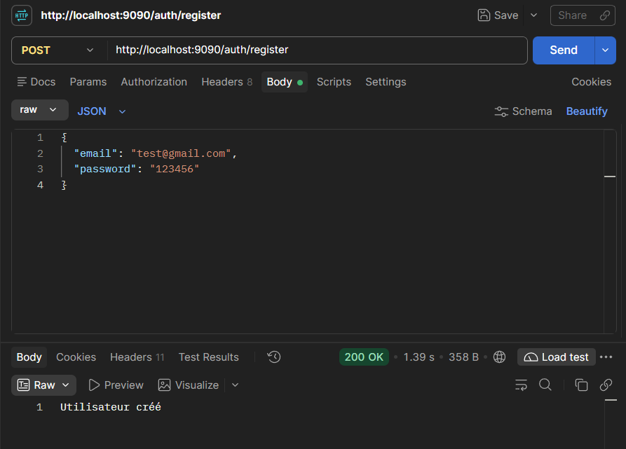
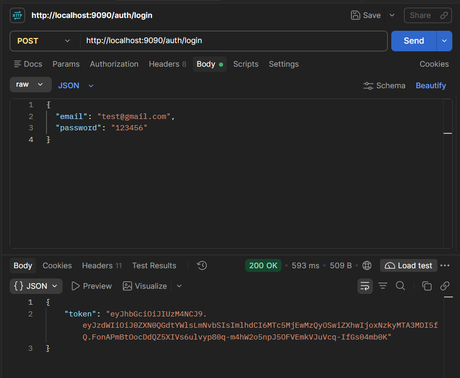
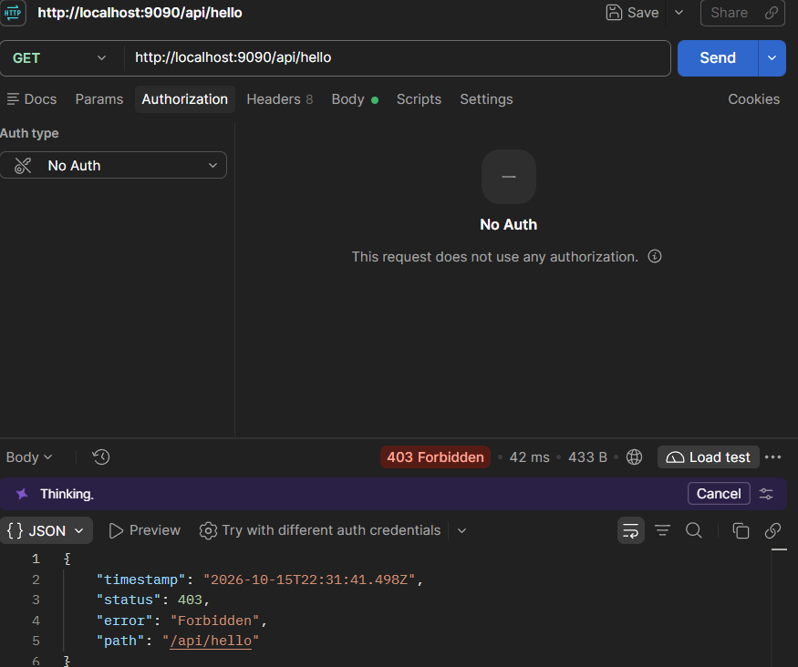
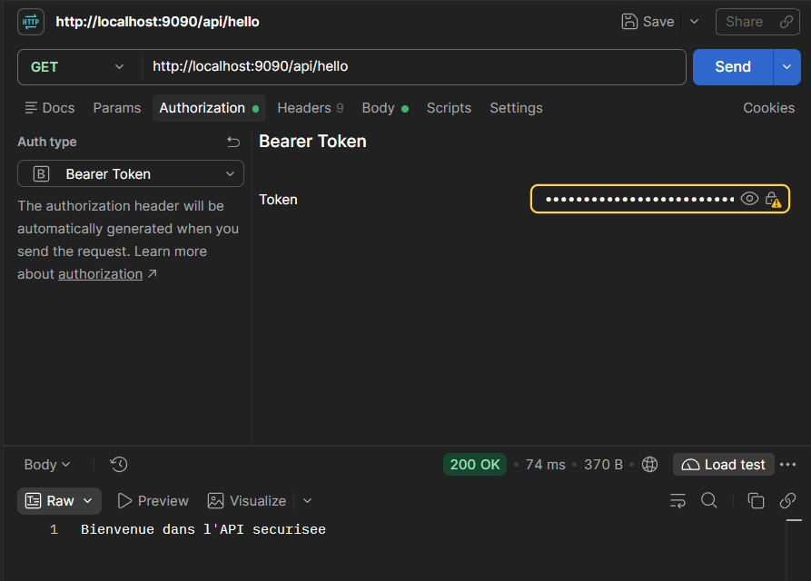

# Spring Boot Security — JWT Authentication

## Description

Ce projet consiste à développer et sécuriser une API REST avec **Spring Boot, Spring Security et JSON Web Token (JWT)**.

Il permet l'inscription et l'authentification des utilisateurs, la génération de tokens JWT et la protection des endpoints REST.

## Technologies utilisées

- Java 21+
- Spring Boot 4
- Spring Security
- JWT (JJWT 0.13.0)
- Spring Data JPA
- H2 Database
- BCrypt
- Maven
- Postman

## Fonctionnalités

- Inscription des utilisateurs avec vérification de l'unicité de l'e-mail
- Hachage des mots de passe avec BCrypt
- Authentification par e-mail et mot de passe
- Génération et vérification des JWT
- Protection des ressources REST
- Authentification sans session (Stateless)

## Endpoints REST

| Méthode | Endpoint | Description | Accès |
|---|---|---|---|
| POST | `/auth/register` | Inscription d'un utilisateur | Public |
| POST | `/auth/login` | Authentification et génération JWT | Public |
| GET | `/api/hello` | Accès à une ressource sécurisée | JWT requis |
| GET | `/api/profile` | Profil de l'utilisateur connecté | JWT requis |

## Tests avec Postman

### 1. Inscription d'un utilisateur

**Endpoint :** `POST /auth/register`

L'utilisateur fournit son adresse e-mail et son mot de passe. Le mot de passe est haché avec BCrypt avant l'enregistrement dans la base de données H2.

**Résultat :** `200 OK — Utilisateur créé`

### 2. Authentification et génération JWT

**Endpoint :** `POST /auth/login`

Après vérification des identifiants, l'application génère un token JWT signé.

**Résultat :** `200 OK` avec un token JWT dans la réponse JSON.

### 3. Protection d'une ressource sans authentification

**Endpoint :** `GET /api/hello`

L'accès à cette ressource nécessite une authentification. Une requête sans JWT doit être refusée par Spring Security.

**Résultat attendu :** `401 Unauthorized` ou `403 Forbidden`, selon la configuration.

### 4. Accès à une ressource avec JWT valide

**Endpoint :** `GET /api/hello`

Le JWT est transmis dans l'en-tête HTTP :

`Authorization: Bearer <JWT>`

Après validation du token, l'accès à la ressource est autorisé.

**Résultat :** `200 OK — Bienvenue dans l'API securisee`

## Architecture de sécurité

Le processus d'authentification repose sur les composants suivants :

- **AuthController** : gère l'inscription et la connexion.
- **UserController** : expose les endpoints protégés.
- **CustomerUserDetailsService** : charge les utilisateurs depuis la base H2.
- **JwtService** : génère et vérifie les tokens JWT.
- **JwtFilter** : intercepte les requêtes HTTP et vérifie les JWT.
- **SecurityConfig** : configure Spring Security, les autorisations et l'authentification.
- **UserRepository** : assure l'accès aux données des utilisateurs.

## Exécution du projet

1. Cloner le dépôt GitHub.
2. Ouvrir le projet dans IntelliJ IDEA.
3. Configurer la clé secrète JWT dans une variable d'environnement.
4. Lancer la classe `Tp2Application`.
5. Tester les endpoints avec Postman.

**URL locale utilisée pour les tests :** `http://localhost:9090`

La base H2 fonctionne en mémoire : les données sont réinitialisées à l'arrêt de l'application.

## Conclusion

Ce TP permet de comprendre l'implémentation d'une authentification JWT dans une API REST Spring Boot, ainsi que les mécanismes de protection des ressources avec Spring Security.

Les tests réalisés avec Postman permettent de vérifier l'inscription, l'authentification et le contrôle d'accès aux endpoints sécurisés.
